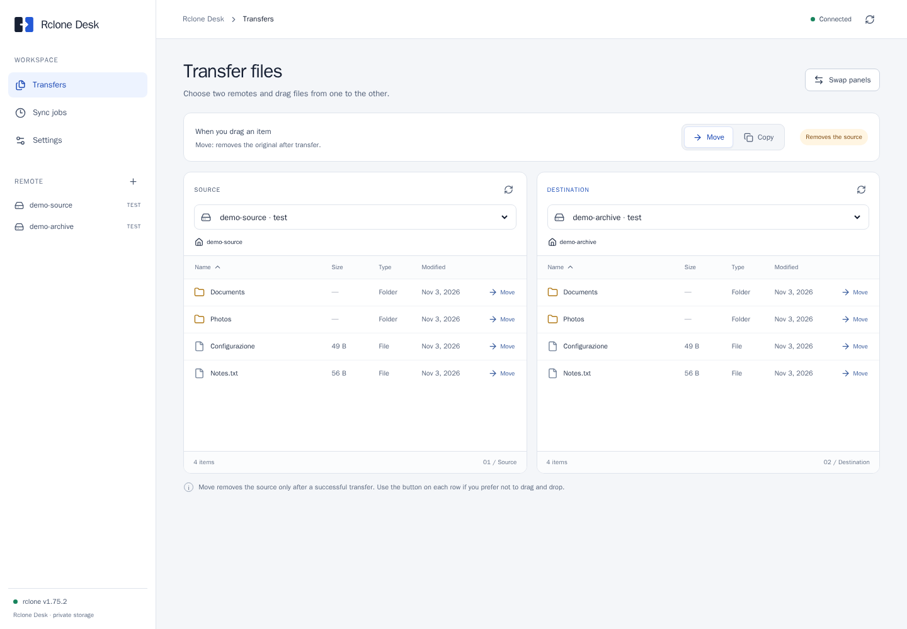
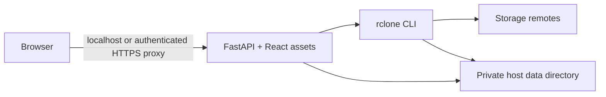

# Rclone Desk


Rclone Desk is an independent, self-hosted web workspace for managing rclone remotes. Browse two remotes side by side, copy or move files, download or delete selected items, create supported storage buckets, and save reusable copy or sync jobs. Transfers run through the rclone command line included in the container; the app does not expose rclone's RC server.

Rclone Desk is not affiliated with the rclone project. The interface supports English and Italian. This is experimental software for a single administrator; there are no user accounts or built-in authentication.



## Run with Docker Compose

Install Docker Engine and the Docker Compose plugin, then clone the repository:

```sh
git clone https://github.com/mauromarano/rclone-desk.git
cd rclone-desk
./scripts/prepare-data.sh
docker compose up --build -d
```

Open <http://localhost:8000>. The default host binding is loopback only. To choose another local port, set `PORT`:

```sh
PORT=8080 docker compose up --build -d
```

The first build compiles rclone and may take several minutes. Allow at least 10 GB of free Docker build storage. The container includes the frontend, backend, and rclone. Node.js, Python, and rclone do not need to be installed on the host. Before first startup, `prepare-data.sh` creates the host data directory with private permissions and gives the top-level directory to container UID 10001. The default directory is `./data` in the repository. To use another directory, export an absolute path before running both the helper and Compose:

```sh
export RCLONE_DESK_DATA_DIR="$HOME/rclone-desk-data"
./scripts/prepare-data.sh
docker compose up --build -d
```

Stop the service with `docker compose down`; host data remains in place. `docker compose down -v` does not remove the bind-mounted data directory. Remove it yourself only when you intend to permanently delete the saved configuration and job data.

For remote access, use an authenticated HTTPS reverse proxy and follow [the deployment guide](docs/deployment.md). Do not publish the app port to an untrusted network: the app itself does not authenticate requests.

## Get started

Add a remote from **New remote** and configure its provider options, or import/edit rclone-compatible INI configuration in **Settings**. Provider authentication requirements vary.

For a credential-free trial, create two **local** remotes and leave the confined test-remote option enabled. Their data is stored under `/data/test-remotes` in the host data directory (`./data/test-remotes` by default). There is no upload feature; sample files can be added there or through another container.

## Features

- Browse files and folders on two configured remotes.
- Copy or move a selected file or folder. Move removes the source after a successful transfer. Existing destination names may be overwritten according to rclone behavior.
- Download individual files or selected files as an archive. Folders are not included in archive downloads. Downloads are prepared in temporary storage before delivery, limited to 1 GiB total, five minutes, and two concurrent downloads.
- Delete selected files or folders, up to 200 items per operation. Deletion cannot be undone.
- Create buckets or containers at the root of supported object storage backends when credentials permit. Currently enabled for S3, B2, Google Cloud Storage, Azure Blob, Swift, and Storj.
- Save copy or sync jobs, run them manually, and optionally schedule them with a cron expression. Sync can delete destination-only files; manual runs require confirmation, and scheduled sync requires explicit acknowledgement when configured.

- Cancel queued or running operations. Cancellation stops further work and does not undo files already copied, moved, or deleted.

## Architecture



## Security and data

The application has **no built-in authentication or user accounts**. Anyone who can reach it can manage configured credentials and perform file operations. The default Compose port is bound to `127.0.0.1`; retain that boundary and put a reverse proxy with authentication in front if remote access is needed. See [deployment](docs/deployment.md).

The host data directory mounted at `/data` contains `rclone.conf`, job state, and confined local test data. See [backup and restore](docs/backup.md). Treat configuration exports and backups as secrets: provider credentials or tokens may be present. Rclone's obscured values are reversible and are not encryption.

## Limitations

- Provider behavior and credential requirements come from the rclone version in the image and the provider.
- The confined local test remotes protect only their configured test roots. Other remotes can access what their credentials allow.
- Sync and deletion can remove data. Check the selected source and destination before confirming.
- There is no built-in authentication, multi-user access control, upload interface, or provider credential provisioning.
- The app is designed to run as a single backend worker; do not scale it to multiple replicas.

## Scheduling

Cron uses five fields and runs in UTC. When both day-of-month and weekday are restricted, either may match. Missed runs during downtime are skipped; active work interrupted by a restart is marked failed. Configuration edits are blocked while remote operations are active. The in-memory operation list is bounded and is not a durable audit log.

## Project status

The first experimental prerelease is [v0.1.0](https://github.com/mauromarano/rclone-desk/releases/tag/v0.1.0). The published image is `ghcr.io/mauromarano/rclone-desk:v0.1.0`, available for Linux amd64 and arm64. Its multi-architecture manifest digest is `sha256:64cf480d2f94981af8aa15b7d4400fe997e2724c8318c074c4fb282a5a45462a`.

For a prebuilt installation from a repository checkout:

```sh
./scripts/prepare-data.sh
DATA_DIR="${RCLONE_DESK_DATA_DIR:-$PWD/data}"
case "$DATA_DIR" in /*) ;; *) DATA_DIR="$PWD/$DATA_DIR" ;; esac
docker run -d --name rclone-desk --restart unless-stopped \
  --cap-drop=ALL --security-opt=no-new-privileges \
  --memory=2g --cpus=2 --pids-limit=256 \
  -p 127.0.0.1:8000:8000 \
  --mount "type=bind,src=$DATA_DIR,dst=/data" \
  ghcr.io/mauromarano/rclone-desk:v0.1.0
```

Run `./scripts/prepare-data.sh` before the first `docker run` when using a repository checkout. If you are deploying the image without cloning the repository, create the bind directory with the runtime UID:

```sh
sudo install -d -m 700 -o 10001 -g 10001 ./data
```

For an existing installation, preserve its original data and follow [the migration and backup guide](docs/backup.md). See [the changelog](CHANGELOG.md), [validation results](docs/RELEASE_VALIDATION.md), [roadmap](ROADMAP.md), [support](SUPPORT.md), and [contribution guide](CONTRIBUTING.md).

## License

Rclone Desk is available under the [MIT License](LICENSE). Third-party components retain their own licenses; see the [third-party notices](THIRD_PARTY_NOTICES.md).
